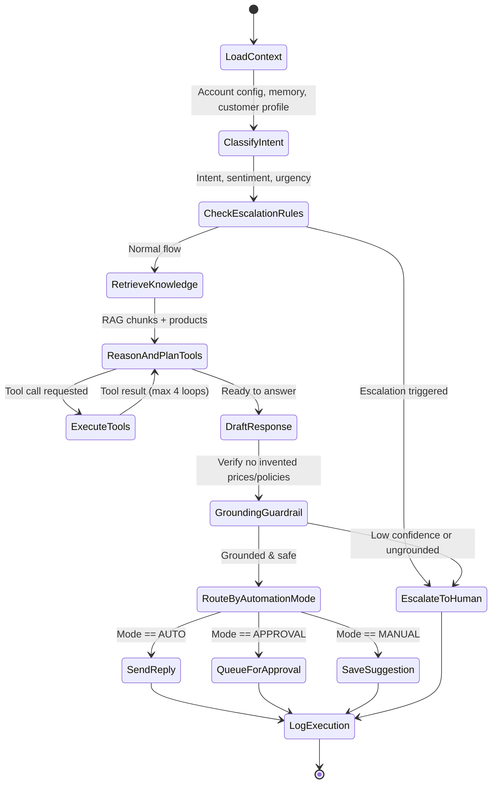

# InstaPilot AI — AI Agent Architecture

## 1. Design Philosophy

Each Instagram account has an independent, stateful **LangGraph** agent—not a stateless prompt-response wrapper. Every run is deterministic in its orchestration, strictly scoped to a single `instagram_account_id`, grounded in retrieved facts, and fully audited.

## 2. LangGraph Execution Graph

## 3. Node Responsibilities

1. **`LoadContext`**: Loads `agents` config (identity, instructions, tone, language), `customers` record, `conversations.ai_summary`, and the last $N$ messages (e.g., 12 turns).
2. **`ClassifyIntent`**: Structured output classification (`product_inquiry`, `pricing_question`, `order_support`, `booking_request`, `complaint`, `spam_or_greeting`, `human_request`) + sentiment (`positive`, `neutral`, `frustrated`).
3. **`CheckEscalationRules`**: Evaluates configured escalation keywords, high frustration sentiment, or explicit "talk to a human" requests before spending tool cycles.
4. **`RetrieveKnowledge`**: Runs hybrid/semantic `pgvector` search on `knowledge_chunks` strictly filtered by `WHERE instagram_account_id = :account_id`.
5. **`ReasonAndPlanTools`**: LLM reasons with bound allowlisted tools and system instructions. Capped at max 4 tool-call iterations to prevent infinite loops.
6. **`GroundingGuardrail`**: Verifies that any price, stock status, or policy claim appears in retrieved `products` / `knowledge_chunks` or tool outputs. If missing, rewrites to a clarifying/deferral response or escalates.
7. **`RouteByAutomationMode`**:
   - **Auto Mode**: Calls `send_instagram_reply` (if within Meta 24h DM window or 7d comment private reply window).
   - **Approval Mode**: Stores `delivery_status = 'pending_approval'` and notifies operators.
   - **Manual Mode**: Stores suggested draft in `agent_execution_logs` / UI suggestion slot without sending.
8. **`LogExecution`**: Writes full trace to `agent_execution_logs` and updates `conversations.ai_summary` asynchronously if turn count threshold reached.

## 4. Validated Tool Registry

All tools bind `workspace_id` and `instagram_account_id` server-side (invisible to the LLM):

| Tool Name | Purpose | Validation & Constraints |
| :--- | :--- | :--- |
| `search_knowledge_base` | Semantic + keyword search over account's FAQs, policies, PDFs, URLs | `top_k <= 6`; hard-filtered by `instagram_account_id`. |
| `search_products` | Search structured `products` table by query/category | Returns exact `price_cents`, `currency`, `stock_status`. |
| `get_product_details` | Fetch full product record by `product_id` or `sku` | Must belong to `instagram_account_id`. |
| `create_lead` | Create a CRM lead for the current customer | Validates `status` enum and `interest_category`; prevents duplicate open leads. |
| `update_lead` | Update existing lead status/notes/follow-up | Scoped to `customer_id` + `instagram_account_id`. |
| `get_customer_history` | Fetch customer past conversations, tags, and lead status | Scoped to `instagram_account_id`. |
| `request_human_support` | Mark conversation `pending_human`, pause AI, notify operators | Always allowed as safety valve. |
| `send_instagram_reply` | Dispatch DM or comment reply via Meta API | **Blocked** in `approval` / `manual` modes and **blocked** if 24h window expired. |

## 5. RAG & Memory Architecture

- **Chunking:** Recursive character/markdown splitting (~500 tokens, 75-token overlap) preserving document title & section metadata.
- **Embeddings:** Configurable (`nomic-embed-text` 768-dim via Ollama locally, or OpenAI/Gemini embeddings). All chunks in a `knowledge_base` share one embedding model dimension.
- **Conversation Memory:**
  - *Short-term:* Last 10–15 messages from `messages` table.
  - *Long-term:* Rolling `conversations.ai_summary` updated periodically + structured `customers.notes` and `leads` history.

## 6. Configurable LLM Provider Layer

A thin factory (`get_chat_model(provider, model, temperature)`) supports:
- **Google Gemini & Groq APIs (Primary / Selected):** `gemini-2.5-flash` (chat) + Gemini embeddings (`768`-dim) or Groq (`llama-3.3-70b-versatile`) using user-supplied API keys—no local Ollama installation required on the developer's laptop.
- **Ollama / OpenAI (Optional):** Supported via the same provider interface if self-hosting or switching models later.
