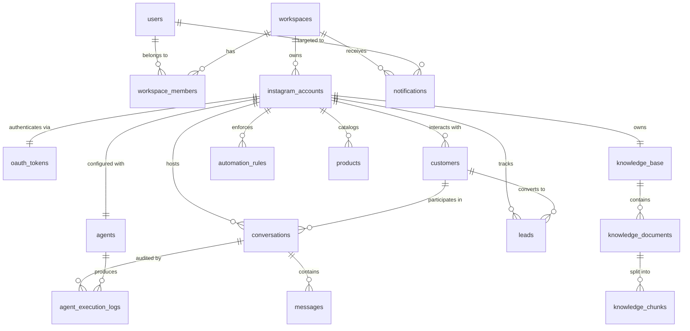

# InstaPilot AI — Database Design

## 1. Engine & Extensions

- **Primary Database:** PostgreSQL 16
- **Required Extensions:**
  - `pgcrypto` / `uuid-ossp` (UUID v4/v7 primary keys)
  - `vector` (`pgvector` for RAG embeddings & HNSW similarity search)

## 2. Multi-Tenant & Account Isolation Strategy

Every domain table carries `workspace_id` (tenant boundary) and, for account-scoped data, `instagram_account_id` (agent/brand boundary):
1. **Application-Layer Enforcement:** Every FastAPI repository/service method requires `(workspace_id, instagram_account_id)` context derived from the authenticated user's membership or verified webhook target.
2. **PostgreSQL Row-Level Security (RLS) Ready:** All tenant tables include `workspace_id` so RLS policies (`SET LOCAL app.current_workspace_id = '...'`) can be enabled cleanly for SaaS defense-in-depth.
3. **Composite Foreign Keys / Integrity Checks:** Child records (`conversations`, `knowledge_documents`, `leads`, `agents`) reference `instagram_accounts(id)` with `ON DELETE CASCADE` (or controlled purge), ensuring no orphan cross-account records can exist.

## 3. Entity-Relationship Diagram

## 4. Core Tables Specification

### 4.1 `users`
| Column | Type | Constraints | Notes |
| :--- | :--- | :--- | :--- |
| `id` | `UUID` | `PK` | User ID |
| `email` | `VARCHAR(255)` | `UNIQUE, NOT NULL` | Lowercased email |
| `password_hash` | `TEXT` | `NOT NULL` | Argon2id hash |
| `full_name` | `VARCHAR(120)` | `NOT NULL` | Display name |
| `is_active` | `BOOLEAN` | `DEFAULT TRUE` | Account status |
| `created_at` | `TIMESTAMPTZ` | `DEFAULT NOW()` | |
| `updated_at` | `TIMESTAMPTZ` | `DEFAULT NOW()` | |

### 4.2 `workspaces`
| Column | Type | Constraints | Notes |
| :--- | :--- | :--- | :--- |
| `id` | `UUID` | `PK` | Tenant ID |
| `name` | `VARCHAR(120)` | `NOT NULL` | Workspace name |
| `slug` | `VARCHAR(120)` | `UNIQUE, NOT NULL` | URL-safe identifier |
| `owner_id` | `UUID` | `FK -> users.id` | Primary owner |
| `plan_tier` | `VARCHAR(32)` | `DEFAULT 'private'` | `private`, `starter`, `pro` |
| `created_at` | `TIMESTAMPTZ` | `DEFAULT NOW()` | |

### 4.3 `workspace_members`
| Column | Type | Constraints | Notes |
| :--- | :--- | :--- | :--- |
| `id` | `UUID` | `PK` | |
| `workspace_id` | `UUID` | `FK -> workspaces.id, NOT NULL` | |
| `user_id` | `UUID` | `FK -> users.id, NOT NULL` | |
| `role` | `VARCHAR(24)` | `NOT NULL` | `owner`, `admin`, `operator`, `viewer` |
| `created_at` | `TIMESTAMPTZ` | `DEFAULT NOW()` | |
- **Unique Constraint:** `(workspace_id, user_id)`

### 4.4 `instagram_accounts`
| Column | Type | Constraints | Notes |
| :--- | :--- | :--- | :--- |
| `id` | `UUID` | `PK` | Internal account UUID |
| `workspace_id` | `UUID` | `FK -> workspaces.id, NOT NULL` | Tenant isolation |
| `ig_user_id` | `VARCHAR(64)` | `UNIQUE, NOT NULL` | Meta Instagram User/Account ID |
| `ig_username` | `VARCHAR(100)` | `NOT NULL` | `@handle` |
| `account_type` | `VARCHAR(32)` | `NOT NULL` | `BUSINESS` or `MEDIA_CREATOR` |
| `profile_picture_url` | `TEXT` | `NULL` | |
| `connection_status` | `VARCHAR(32)` | `NOT NULL` | `connected`, `token_expiring`, `disconnected`, `error` |
| `automation_mode` | `VARCHAR(16)` | `DEFAULT 'manual'` | `auto`, `approval`, `manual` |
| `is_agent_enabled` | `BOOLEAN` | `DEFAULT FALSE` | Master ON/OFF switch |
| `webhook_subscribed` | `BOOLEAN` | `DEFAULT FALSE` | `/subscribed_apps` status |
| `last_webhook_at` | `TIMESTAMPTZ` | `NULL` | Health indicator |
| `created_at` | `TIMESTAMPTZ` | `DEFAULT NOW()` | |
| `updated_at` | `TIMESTAMPTZ` | `DEFAULT NOW()` | |

### 4.5 `oauth_tokens`
| Column | Type | Constraints | Notes |
| :--- | :--- | :--- | :--- |
| `id` | `UUID` | `PK` | |
| `workspace_id` | `UUID` | `FK -> workspaces.id, NOT NULL` | |
| `instagram_account_id` | `UUID` | `FK -> instagram_accounts.id, UNIQUE` | 1:1 with IG account |
| `encrypted_access_token` | `TEXT` | `NOT NULL` | AES-256-GCM / Fernet ciphertext |
| `token_type` | `VARCHAR(32)` | `DEFAULT 'long_lived'` | |
| `scopes` | `TEXT[]` | `NOT NULL` | Granted Meta scopes |
| `issued_at` | `TIMESTAMPTZ` | `NOT NULL` | Used to enforce >24h refresh rule |
| `expires_at` | `TIMESTAMPTZ` | `NOT NULL` | 60-day expiry tracking |
| `last_refreshed_at` | `TIMESTAMPTZ` | `NULL` | |

### 4.6 `agents`
| Column | Type | Constraints | Notes |
| :--- | :--- | :--- | :--- |
| `id` | `UUID` | `PK` | |
| `workspace_id` | `UUID` | `FK -> workspaces.id, NOT NULL` | |
| `instagram_account_id` | `UUID` | `FK -> instagram_accounts.id, UNIQUE` | 1:1 dedicated agent |
| `name` | `VARCHAR(100)` | `NOT NULL` | Agent display identity |
| `system_instructions` | `TEXT` | `NOT NULL` | Core persona & rules |
| `personality` | `VARCHAR(64)` | `DEFAULT 'helpful'` | Tone preset |
| `communication_style` | `JSONB` | `DEFAULT '{}'` | Emoji, length, formality flags |
| `language_config` | `JSONB` | `DEFAULT '{"primary":"en","auto_detect":true}'` | |
| `llm_provider` | `VARCHAR(32)` | `DEFAULT 'ollama'` | `ollama`, `openai`, `gemini`, `groq` |
| `llm_model` | `VARCHAR(64)` | `DEFAULT 'llama3.1:8b'` | |
| `temperature` | `FLOAT` | `DEFAULT 0.3` | Low temp for groundedness |
| `enabled_tools` | `TEXT[]` | `NOT NULL` | Allowlisted tool names |
| `tool_permissions` | `JSONB` | `DEFAULT '{}'` | Per-tool constraints |
| `escalation_config` | `JSONB` | `DEFAULT '{}'` | Keywords, confidence threshold |
| `updated_at` | `TIMESTAMPTZ` | `DEFAULT NOW()` | |

### 4.7 `customers`
| Column | Type | Constraints | Notes |
| :--- | :--- | :--- | :--- |
| `id` | `UUID` | `PK` | |
| `workspace_id` | `UUID` | `FK -> workspaces.id, NOT NULL` | |
| `instagram_account_id` | `UUID` | `FK -> instagram_accounts.id, NOT NULL` | Account-isolated customer record |
| `ig_scoped_user_id` | `VARCHAR(64)` | `NOT NULL` | IGSID from Meta webhook |
| `ig_username` | `VARCHAR(100)` | `NULL` | |
| `full_name` | `VARCHAR(150)` | `NULL` | |
| `profile_pic_url` | `TEXT` | `NULL` | |
| `tags` | `TEXT[]` | `DEFAULT '{}'` | |
| `notes` | `TEXT` | `NULL` | Operator notes |
| `first_seen_at` | `TIMESTAMPTZ` | `DEFAULT NOW()` | |
| `last_interaction_at` | `TIMESTAMPTZ` | `DEFAULT NOW()` | |
- **Unique Constraint:** `(instagram_account_id, ig_scoped_user_id)`

### 4.8 `conversations`
| Column | Type | Constraints | Notes |
| :--- | :--- | :--- | :--- |
| `id` | `UUID` | `PK` | |
| `workspace_id` | `UUID` | `FK -> workspaces.id, NOT NULL` | |
| `instagram_account_id` | `UUID` | `FK -> instagram_accounts.id, NOT NULL` | |
| `customer_id` | `UUID` | `FK -> customers.id, NOT NULL` | |
| `channel` | `VARCHAR(24)` | `DEFAULT 'dm'` | `dm`, `comment_thread` |
| `status` | `VARCHAR(24)` | `DEFAULT 'open'` | `open`, `pending_human`, `resolved`, `snoozed` |
| `automation_mode_override` | `VARCHAR(16)` | `NULL` | `auto`, `approval`, `manual`, or `NULL` (inherit) |
| `is_ai_paused` | `BOOLEAN` | `DEFAULT FALSE` | Conversation-level pause |
| `assigned_user_id` | `UUID` | `FK -> users.id, NULL` | Human assignee |
| `ai_summary` | `TEXT` | `NULL` | Rolling AI summary |
| `last_intent` | `VARCHAR(64)` | `NULL` | Latest classified intent |
| `window_expires_at` | `TIMESTAMPTZ` | `NULL` | Meta 24-hour messaging window deadline |
| `unread_count` | `INT` | `DEFAULT 0` | |
| `last_message_at` | `TIMESTAMPTZ` | `DEFAULT NOW()` | |

### 4.9 `messages`
| Column | Type | Constraints | Notes |
| :--- | :--- | :--- | :--- |
| `id` | `UUID` | `PK` | |
| `workspace_id` | `UUID` | `FK -> workspaces.id, NOT NULL` | |
| `instagram_account_id` | `UUID` | `FK -> instagram_accounts.id, NOT NULL` | |
| `conversation_id` | `UUID` | `FK -> conversations.id, NOT NULL` | |
| `external_message_id` | `VARCHAR(128)` | `UNIQUE, NULL` | Meta `mid` or `comment_id` (idempotency) |
| `sender_type` | `VARCHAR(16)` | `NOT NULL` | `customer`, `ai_agent`, `human_operator`, `system` |
| `message_type` | `VARCHAR(24)` | `DEFAULT 'text'` | `text`, `image`, `story_reply`, `comment`, `private_reply` |
| `content` | `TEXT` | `NOT NULL` | Message body |
| `media_url` | `TEXT` | `NULL` | Attachment reference |
| `delivery_status` | `VARCHAR(24)` | `DEFAULT 'received'` | `received`, `pending_approval`, `sent`, `failed` |
| `metadata` | `JSONB` | `DEFAULT '{}'` | Reply-to, comment media_id, etc. |
| `created_at` | `TIMESTAMPTZ` | `DEFAULT NOW()` | |

### 4.10 `knowledge_base`, `knowledge_documents`, `knowledge_chunks`, and `products`
- **`knowledge_base`**: `id (PK)`, `workspace_id`, `instagram_account_id (UNIQUE FK)`, `name`, `embedding_model`, `updated_at`.
- **`knowledge_documents`**: `id (PK)`, `workspace_id`, `instagram_account_id`, `knowledge_base_id (FK)`, `source_type` (`manual_text`, `faq`, `policy`, `pdf`, `website_url`), `title`, `raw_content`, `source_url`, `file_path`, `status` (`pending`, `indexed`, `failed`), `is_enabled`, `created_at`.
- **`knowledge_chunks`**: `id (PK)`, `workspace_id`, `instagram_account_id`, `document_id (FK -> knowledge_documents.id ON DELETE CASCADE)`, `chunk_index`, `content`, `metadata (JSONB)`, `embedding VECTOR(768)` (or configurable dimension matching embedding model).
  - **Index:** `CREATE INDEX idx_chunks_embedding_hnsw ON knowledge_chunks USING hnsw (embedding vector_cosine_ops);` + `idx_chunks_account` on `(instagram_account_id)`.
- **`products`**: `id (PK)`, `workspace_id`, `instagram_account_id`, `sku`, `name`, `description`, `price_cents`, `currency`, `stock_status` (`in_stock`, `out_of_stock`, `preorder`), `product_url`, `metadata (JSONB)`, `is_active`. Enables exact deterministic lookups for `search_products` and `get_product_details` without hallucination.

### 4.11 `leads`
- `id (PK)`, `workspace_id`, `instagram_account_id`, `customer_id (FK)`, `conversation_id (FK, NULL)`, `status` (`new`, `qualified`, `contacted`, `converted`, `lost`), `interest_category`, `estimated_value_cents`, `notes`, `follow_up_at (TIMESTAMPTZ)`, `assigned_user_id (FK, NULL)`, `created_at`, `updated_at`.

### 4.12 `automation_rules`
- `id (PK)`, `workspace_id`, `instagram_account_id`, `name`, `trigger_type` (`dm_received`, `comment_received`, `keyword_match`), `conditions (JSONB)`, `actions (JSONB)`, `priority (INT)`, `is_enabled (BOOLEAN)`, `created_at`.

### 4.13 `agent_execution_logs`
- `id (PK)`, `workspace_id`, `instagram_account_id`, `agent_id (FK)`, `conversation_id (FK)`, `trigger_message_id (FK)`, `intent`, `retrieved_doc_ids (UUID[])`, `tools_called (JSONB)`, `reasoning_summary`, `draft_response`, `final_action` (`sent`, `queued_approval`, `suggested_only`, `escalated`, `failed`), `llm_provider`, `llm_model`, `tokens_prompt`, `tokens_completion`, `latency_ms`, `error_message`, `created_at`.

### 4.14 `notifications`
- `id (PK)`, `workspace_id`, `user_id (FK, NULL — null means broadcast to workspace)`, `instagram_account_id (FK, NULL)`, `type` (`escalation`, `approval_needed`, `token_expiring`, `webhook_error`, `follow_up_due`), `title`, `body`, `link_url`, `is_read (BOOLEAN DEFAULT FALSE)`, `created_at`.

## 5. Key Indexes

- `idx_conversations_inbox`: `(workspace_id, instagram_account_id, status, last_message_at DESC)`
- `idx_messages_conv_time`: `(conversation_id, created_at ASC)`
- `idx_leads_filter`: `(workspace_id, instagram_account_id, status, follow_up_at)`
- `idx_logs_account_time`: `(instagram_account_id, created_at DESC)`
- `idx_notifications_unread`: `(workspace_id, is_read, created_at DESC)`
