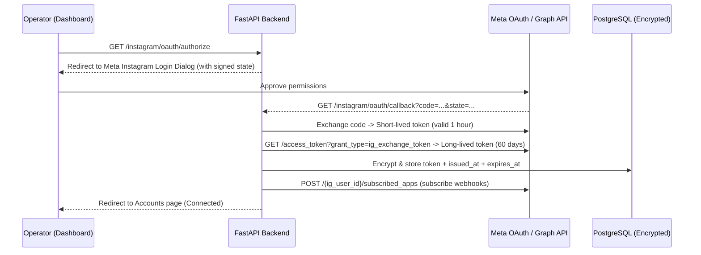

# InstaPilot AI — Instagram Integration Specification

## 1. Official Meta API Strategy

InstaPilot AI uses **official Meta Instagram APIs only**—never password-based logins, private/undocumented endpoints, or browser scraping.

### Two Official Meta Pathways
Meta currently supports two official API configurations for Instagram Professional accounts (Business or Creator):
1. **Instagram API with Instagram Login** (`graph.instagram.com`): Connects Instagram Professional accounts directly **without** requiring a linked Facebook Page. Uses `instagram_business_basic`, `instagram_business_manage_messages`, and `instagram_business_manage_comments` (or `instagram_basic` / `instagram_manage_messages` depending on app setup).
2. **Instagram API with Facebook Login / Messenger Platform** (`graph.facebook.com`): Connects Instagram Professional accounts linked to a Facebook Page, using `instagram_basic`, `instagram_manage_messages`, `instagram_manage_comments`, `pages_manage_metadata`, `pages_read_engagement`.

**Recommended Default:** **Instagram API with Instagram Login** (`graph.instagram.com`) for simpler onboarding (no Facebook Page linking friction), while keeping the adapter layer clean if Facebook Login is ever needed.

## 2. OAuth 2.0 & Token Lifecycle

### Token Refresh Rules (Verified against Meta Docs)
- Long-lived tokens expire after **60 days** (`5,183,944` seconds).
- Refresh endpoint: `GET https://graph.instagram.com/refresh_access_token?grant_type=ig_refresh_token&access_token=...`
- **Strict Meta Rule:** A token can only be refreshed if it is **at least 24 hours old** AND **not yet expired**.
- **Scheduled Worker Job:** Daily ARQ cron checks `oauth_tokens` where `expires_at < NOW() + INTERVAL '14 days'` and `issued_at < NOW() - INTERVAL '24 hours'`, refreshes them, and resets the 60-day clock. If refresh fails or token is expired, marks `connection_status = 'error'` and triggers a reconnection notification.

## 3. Webhooks & Event Processing

- **Verification (`GET /api/v1/webhooks/instagram`):** Validates `hub.mode == 'subscribe'` and `hub.verify_token == META_VERIFY_TOKEN`, returns `hub.challenge`.
- **Signature Verification (`POST`):** Validates `X-Hub-Signature-256` HMAC-SHA256 against `META_APP_SECRET`.
- **Subscribed Fields:**
  - `messages` (incoming DMs, attachments, story replies)
  - `message_reactions`
  - `messaging_postbacks`
  - `messaging_referral`
  - `messaging_seen`
  - `comments` (comments on posts, reels, ads)
- **Prerequisite:** Account owner must have **"Allow Access to Messages"** enabled in the Instagram mobile app (*Settings -> Messages and story replies -> Message controls -> Connected tools*).

## 4. Messaging & Comment Windows (Technical Limitations)

| Capability | Meta Rule / Constraint | Platform Handling |
| :--- | :--- | :--- |
| **Standard DM Reply** | **24-hour messaging window** from the customer's last message. | Store `conversations.window_expires_at = last_customer_msg + 24h`. Block AI/manual sends with clear UI warning if expired. |
| **Comment Private Reply** | Send **1 private DM** referencing `comment_id` within **7 days** of comment creation (Live comments: only during live broadcast). | Track `comment_id` and `comment_created_at`; once customer replies to that DM, standard 24h window opens. |
| **Public Comment Reply** | Reply publicly via `POST /{comment_id}/replies` (`instagram_business_manage_comments`). | Governed by Automation Rules (e.g., keyword match). |
| **App Review** | Standard Access works only for App Admins/Developers/Testers. | Required **Meta App Review** (Advanced Access) before handling messages from the general public or external SaaS customers. |

## 5. Rate Limits & Error Handling

- **Send API (General DMs):** Up to **300 calls/sec** per IG account for text/links/stickers; **10 calls/sec** for audio/video.
- **Private Replies to Comments:** Hard ceiling of **750 calls/hour** per IG account (posts/reels).
- **Graph API BUC Limit:** $4,800 \times \text{Impressions}$ calls per 24 hours.
- **Implementation:** Redis token-bucket rate limiter per `instagram_account_id` + exponential backoff on HTTP `429` or Meta error codes (`4`, `17`, `32`, `613`).
