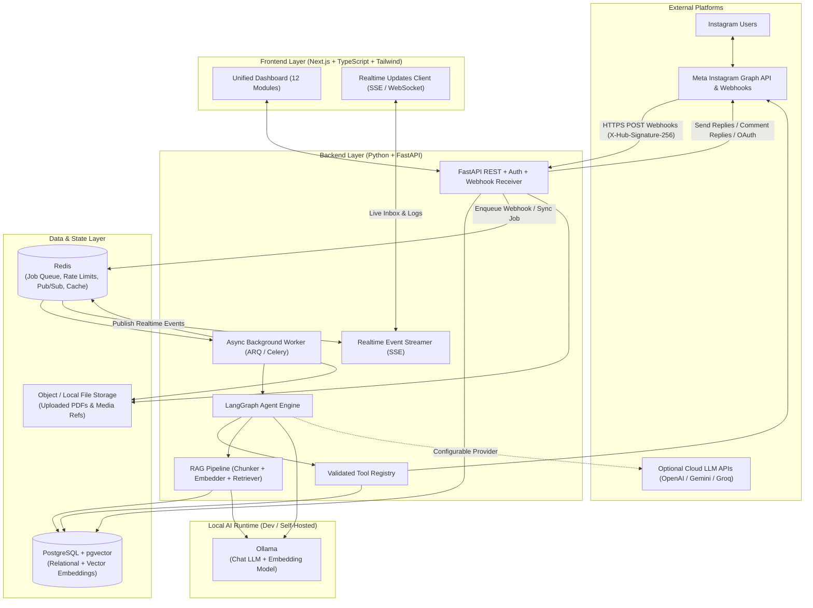

# InstaPilot AI — System Architecture

## 1. Architectural Philosophy

InstaPilot AI follows a **Modular Monolith + Background Worker** architecture designed for:
- **Zero-cost local development** and **low-cost production hosting**.
- **Strict multi-tenant & multi-account isolation** (`workspace_id` + `instagram_account_id`).
- **Event-driven reliability**: Meta webhooks are acknowledged immediately (`< 500ms` HTTP 200), persisted, and processed asynchronously by workers.
- **Solo-developer maintainability**: One Next.js frontend repo/app, one FastAPI backend codebase (serving both HTTP API and worker entrypoints), PostgreSQL (+ `pgvector`), and Redis.

## 2. High-Level System Diagram

## 3. Component Responsibilities

| Component | Technology | Responsibility |
| :--- | :--- | :--- |
| **Web Dashboard** | Next.js (App Router), TypeScript, Tailwind CSS | 12-module SaaS UI, auth session handling, Unified Inbox, Agent Config, CRM, Analytics. |
| **API Server** | Python 3.11+, FastAPI, Pydantic v2 | REST APIs, JWT/session auth, RBAC enforcement, Meta OAuth callbacks, Webhook signature verification & ingestion, SSE event stream. |
| **Background Worker** | Python + ARQ (Redis-backed async queue) | Webhook event processing, LangGraph agent execution, PDF/URL RAG ingestion, token refresh jobs, follow-up reminders, retry with exponential backoff. |
| **AI Agent Engine** | LangGraph + LangChain Core | Stateful multi-step agent graph: intent classification, memory & RAG retrieval, reasoning, tool execution, safety/grounding check, escalation. |
| **LLM & Embeddings** | Configurable Provider (Gemini / Groq API default; Ollama optional) | Cloud API inference via user-provided Gemini or Groq API keys (zero local GPU/Ollama install required); provider abstraction keeps local Ollama optional. |
| **Primary Database** | PostgreSQL 16 + `pgvector` | All relational entities, tenant/account isolation, conversation memory, and vector embeddings for RAG. |
| **Broker & Cache** | Redis 7 | Job queue (ARQ), per-account rate-limit counters, webhook deduplication keys, Redis Pub/Sub for SSE live UI updates. |
| **CI/CD & Scheduled Triggers** | GitHub + GitHub Actions | Linting, type-checking, unit/integration tests, container builds, and optional scheduled cron pings (never used as a 24/7 server). |

## 4. Request & Event Flows

### 4.1 Incoming Instagram Message / Comment Flow
1. Meta sends `POST /api/v1/webhooks/instagram` with `X-Hub-Signature-256`.
2. FastAPI verifies HMAC-SHA256 signature using `META_APP_SECRET`, checks idempotency key (`mid` or `comment_id`) in Redis, persists raw event or enqueues job in Redis, and returns `200 OK` immediately.
3. ARQ Worker picks up the job, resolves `instagram_account_id` -> `workspace_id` -> `agent` configuration.
4. Worker upserts `customer` and `conversation`, stores incoming `message`.
5. Worker checks **Automation Mode** (conversation-level override -> account-level setting -> automation rules):
   - If paused or `manual`: AI generates a suggested reply only (saved as draft), emits SSE event to Inbox.
   - If `approval`: AI runs LangGraph (without sending), saves pending reply for human approval, notifies dashboard.
   - If `auto`: AI runs LangGraph; if confidence/policy passes and no escalation triggered, `send_instagram_reply` dispatches via Meta Send API (respecting rate limits & 24h window).
6. All steps, tool calls, tokens, and latency are logged to `agent_execution_logs`.
7. Redis Pub/Sub pushes real-time update to connected dashboard clients via SSE.

## 5. Architectural Decision Records (ADRs)

| ID | Decision | Rationale |
| :--- | :--- | :--- |
| **ADR-01** | **Modular Monolith in FastAPI** over microservices | Solo developer velocity, single deployment, shared Pydantic models, zero network hop overhead between API and AI engine. |
| **ADR-02** | **PostgreSQL + pgvector** over separate vector DB (Pinecone/Qdrant) | Eliminates an extra service to host/pay for; supports transactional consistency and SQL `WHERE instagram_account_id = $1` filtering alongside vector similarity search. |
| **ADR-03** | **ARQ (async Redis queue)** over Celery | FastAPI, LangGraph, `httpx`, and SQLAlchemy async are natively `asyncio`; ARQ avoids sync/async bridge bugs and is lightweight. |
| **ADR-04** | **Server-Sent Events (SSE)** over WebSockets for dashboard live updates | Unidirectional server-to-client updates (new messages, agent logs, notifications) work cleanly over HTTP/2 with standard auth headers and auto-reconnect; client actions use standard REST POST/PATCH. |
| **ADR-05** | **Ollama-first LLM abstraction** | Enables 100% free local development and zero-API-cost testing, while a thin provider interface allows swapping to Gemini/OpenAI/Groq in production if local GPU isn't available. |
